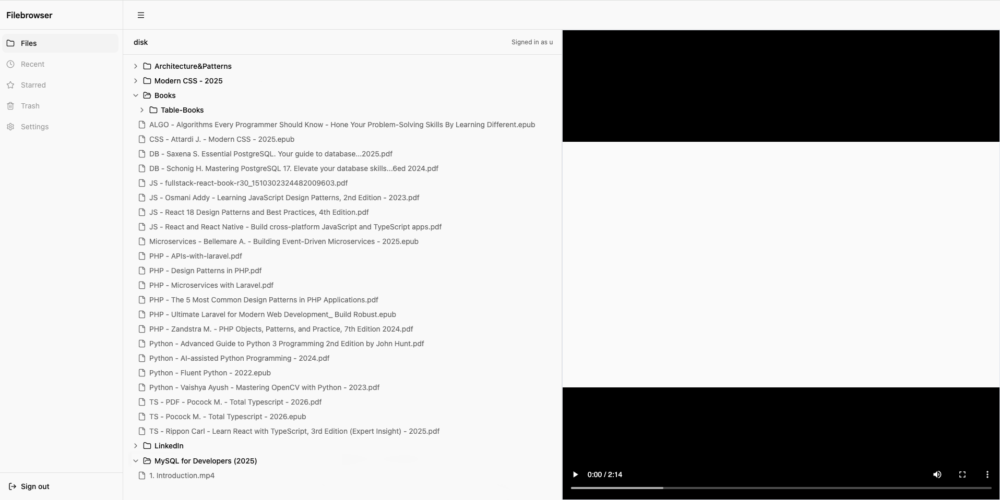

# FileBrowser UI

**Browse the files on your own server from anywhere, open documents, videos and images right in the browser.**



---

FileBrowser is only the interface. The files, the users and the authentication
live on a separate server that implements the **FileBrowser Quantum** API — a
**Go** service exposing `/api/auth`, `/api/users`, `/api/resources` and
`/api/media`.

That means **you need a backend to point this at.** There is no bundled server
here. If you do not have one, this project will not do anything useful on its
own.

## Demo
See a live demo at [nuc.ge](https://nuc.ge)
```
Username: demo
Password: demo123
```

## Tech Stack

|  | Technology |
| --- | --- |
| Framework | Vue 3 (Composition API), TypeScript |
| Build tool | Vite |
| State & routing | Pinia, Vue Router |
| Styling & UI | Tailwind CSS, Shadcn, Reka UI, Lucide icons |
| File preview | OpenFileViewer, PDF.js |
| Testing | Vitest, Vue Test Utils, jsdom |
| Linting & formatting | Oxlint, ESLint, Oxfmt, vue-tsc |

## Requirements
- A reachable [FileBrowser Quantum](https://filebrowserquantum.com/en/) backend, and credentials for it

## Install

```sh
npm install

npm run dev
```

## Project layout

```
src/
  api/          one module per API domain — the only place fetch is called
  stores/       Pinia stores; own state
  components/
    files/      file tree and viewer — presentational
    ui/         shadcn-vue components (generated; do not hand-edit)
  views/        route components
  layouts/      sidebar + router view
  lib/          pure helpers
```

## Commands

| Command | What it does |
| --- | --- |
| `npm run dev` | Start the dev server with hot reload |
| `npm run build` | Type-check, build, then verify no secrets leaked into `dist/` |
| `npm run build-only` | Build only — skips type-check and the secret scan |
| `npm run type-check` | `vue-tsc` |
| `npm run test:unit` | Run the test suite |
| `npm run lint` | `oxlint` then `eslint`, both with `--fix` |
| `npm run format` | `oxfmt` |
| `npm run verify:no-secrets` | Fail if any `.env` value reached `dist/` |


## License

[MIT](LICENSE) © 2026 UchMan